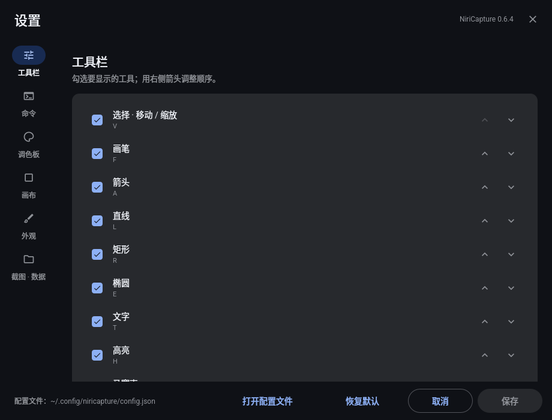
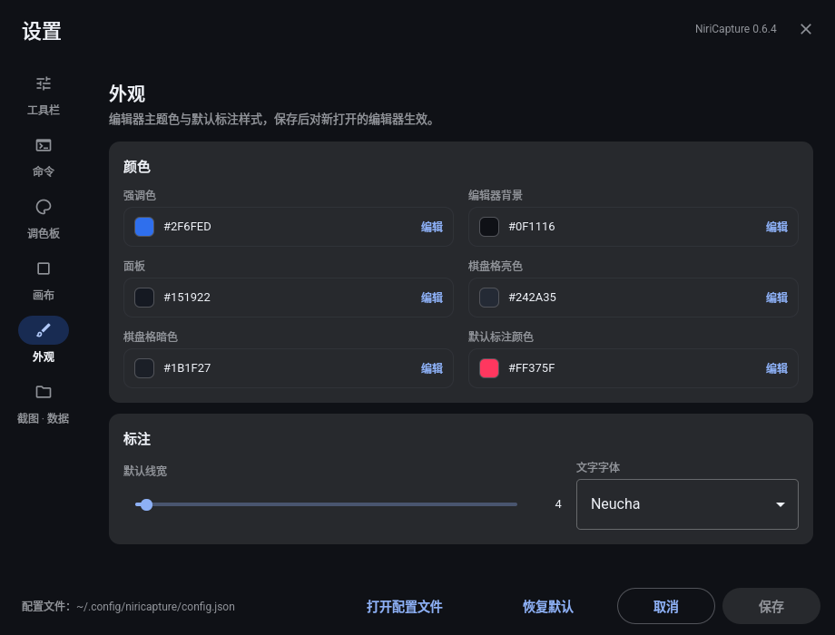

# NiriCapture

[**简体中文**](README.md) | [English](README.en.md)

面向 **Niri** 的原生截图与标注工具。

NiriCapture 在区域/整屏截图时先冻结桌面，再在所有输出上绘制选区覆盖层，随后
直接在冻结选区上显示标注工具栏。冻结后端优先使用可选的 DMS CLI；没有 DMS 时
自动回退到 `grim`。窗口截图使用 **Niri 合成器侧的窗口独立渲染**，不是从桌面
截图中裁剪，因此被其他窗口完全遮挡的窗口、以及位于非当前工作区的窗口，都能
完整截取。


## 界面预览

下面的动图来自真实录屏：冻结桌面、区域覆盖层直接进入编辑状态，
并用 `Q` 展示颜色 / 线宽面板。


[MP4](docs/screenshots/preview.mp4) · [WebM](docs/screenshots/preview.webm) ·
[封面图](docs/screenshots/preview-poster.png)

### 更多截图

| 区域选区 | 编辑器 |
|---|---|
|  |  |
| **颜色 / 线宽** | **独立编辑器：形状面板** |
|  |  |
| **OCR 结果** | **Niri 原生窗口截图** |
|  |  |
| **编辑器** | **设置窗口（Material 3）** |
|  |  |
|  |  |
| **标注导出** | |
|  | |

## 已实现功能

- 区域截图与整屏截图：DMS 可选，`grim` 回退。
- 通过 `niri msg action screenshot-window --id` 进行原生窗口截图。即使目标窗口
  被其他窗口完全覆盖，或位于未激活的工作区，也能正确截取。
- 单进程运行，不依赖 Shell 插件、守护进程或 Quickshell。
- 支持多输出冻结帧选区，正确处理逻辑坐标与物理像素的转换，以及小数缩放。
- 非破坏性标注：选择/移动/缩放、画笔、箭头、直线、空心/填充矩形、
  空心/填充椭圆、文字、高亮、真正的像素化马赛克、真实高斯模糊、序号标记、
  撤销/重做。
- 取色器可从冻结帧或打开的图片中采样颜色（`I`）。
- 文字支持自定义字体；工具栏“文字字体”按钮或设置中的默认字体。
- 智能磁吸：画布/标注边缘与中心、垂直/水平/45° 线，显示参考线；`Alt` 开关。
- `niricapture --tray` 提供常驻托盘：区域/窗口/当前输出截图、编辑器、设置、开机启动、退出。
- `niricapture --settings` 打开 Material 3 设置窗口（内嵌 Qt Quick）：工具、命令、调色板、画布、主题、OCR 和路径均可编辑，带未保存提示、字段校验与只读保护。
- 区域截图和当前输出全屏会直接在冻结选区上显示编辑工具栏，不再打开第二个
  窗口，也不会发生图像跳动。
- 选区手柄基于完整冻结画面调整：缩小时不是裁剪，之后仍可重新放大。
- 界面语言跟随系统；可用 `NIRICAPTURE_LANG=zh_CN` 或 `en` 强制指定。
- JSON 配置 `~/.config/niricapture/config.json` 可控制工具、快捷键、调色板、
  画布默认值、主题、OCR 语言和截图目录。
- 靠近图像的 Material 风格紧凑工具栏，形状按钮直接可选，并提供颜色/线宽
  弹出面板；在深色和浅色桌面上都能正常使用。
- 通过 `wl-copy` 复制、保存 PNG；可选 Tesseract 离线 OCR，识别结果可选中复制。
- 支持把截图钉在屏幕上，也支持打开图片文件或剪贴板图片进入编辑器。
- 不修改 Niri 或 DMS 的源码或配置。

## 截图路径

### 区域截图：冻结帧（DMS 或 grim）

```
niri msg --json outputs          # 逻辑几何、缩放、物理尺寸
        │
        ├─ 优先（可选）：dms screenshot output -o OUTPUT --stdout \
        │                 --no-clipboard --no-file
        ├─ 回退：grim -o OUTPUT -
        │       （每个输出调用一次）
        ▼
  DesktopFrames（不可变 QImage + 逻辑坐标）
        │
        ▼
  每个输出一个 layer-shell 覆盖层，共享同一个全局选区
        │  松开鼠标
        ▼
  冻结 owner 覆盖层上的原位工具栏 + EditorCanvas
        │  复制 / 保存
        ▼
  composeSelection()：按选区主要所属输出的缩放合成
```

覆盖层映射之后不会再重新抓屏。工具栏和标注直接由冻结选区覆盖层绘制，
图像保持原来的屏幕位置，选区手柄可以随时放大或缩小选择范围。这与
DMS Screenshot+ 使用的冻结机制类似（先 `dms screenshot output`，再映射
Quickshell 覆盖层），但 NiriCapture 不依赖 Quickshell，也没有使用其存在崩溃风险的 Quickshell
`ScreencopyView`。相关记录见
[DMS Screenshot+](https://github.com/pcmid/dms-screenshot-plus#backends) 和
[quickshell#1094](https://github.com/quickshell-mirror/quickshell/issues/1094)。

`dms screenshot output --stdout` 输出的是原始 PNG 字节；`--json` 输出的是截图
元数据，两者不会混在一起。启用 DMS 后端时，NiriCapture 会持续读取管道，
避免多显示器大图把管道写满导致死锁。

如果 DMS CLI 不可用，区域/整屏截图会回退到 `grim -o OUTPUT -` 获取同一帧静态
画面。窗口截图**绝不**使用这个回退。

### 窗口截图：Niri 原生独立渲染

`niri msg action screenshot-window --id ID --path PATH --write-to-disk true`
对应 Niri 的 `Action::ScreenshotWindowById`。Niri 会查找目标窗口，然后直接调用
`Mapped::render` 渲染到离屏纹理。它不读取合成后的桌面，因此无论窗口层级、
工作区或输出可见性如何，其他窗口都不会进入结果。图像会保留 Niri 自己的窗口
装饰、圆角、阴影和 alpha（窗口透明度）。

剪贴板副作用来自 Niri：`save_screenshot()` 总会把原始窗口 PNG 设置为 Wayland
剪贴板内容，Niri 没有关闭该行为的参数。之后在 NiriCapture 中复制标注结果时，
剪贴板会被覆盖；如果在选完窗口后取消，剪贴板上会保留 Niri 的原始窗口图。
这是合成器的限制，不是偷偷改用了桌面裁剪。

Niri 26.04 的 `screenshot-window --id` 会在 CLI 进程退出后异步写入 PNG。
NiriCapture 因此会等待文件可读且非空，绝不只凭退出码 0 判断成功。

### 整屏与全部输出

两者都会冻结所需输出：优先调用可选的 `dms screenshot output`，没有 DMS 时
使用 `grim`，并复用区域截图的合成代码。
“全部输出”会以涉及输出中的最大缩放生成一张图；逻辑显示器矩形之间的空隙保持
透明。

## 依赖要求

NiriCapture 使用 Qt 6.8+ 与 LayerShellQt 构建，面向 Wayland/Niri。

构建依赖：

- CMake 3.24+、Ninja、pkgconf、C++23 编译器
- Qt 6.8+ 的 Core / Gui / Widgets / Concurrent 开发包
- Qt Quick / QuickWidgets（`qt6-declarative`，设置窗口使用）
- LayerShellQt 开发包

运行时依赖：

| 组件 | 是否必需 | 用途 |
|---|---|---|
| Niri 26.04（已测试） | 截图模式必需 | JSON IPC、窗口选择与原生窗口截图 |
| Qt 6 + LayerShellQt | 是 | 覆盖层、编辑器和钉图 |
| Qt Quick / QML 模块（`qt6-declarative`） | 是 | 内嵌的 Material 3 设置窗口 |
| `dms`（`dux-shell`） | 可选 | 区域/整屏的首选冻结后端 |
| `grim` | 可选 | 没有 DMS 时区域/整屏的回退 |
| `wl-clipboard` | 复制/剪贴板输入时需要 | Wayland 剪贴板 |
| `tesseract` + 语言包 | 可选 | 离线 OCR |
| `libnotify` | 可选 | 桌面通知 |

区域/整屏截图需要 `dms` 或 `grim` 至少一个；窗口截图不需要两者。
`--editor` 的新建/打开图片不调用截图后端。

NiriCapture **不**需要 Quickshell、Noctalia、Hyprland 头文件或合成器插件。
DMS 只通过公开 CLI 调用，且不是必需依赖。

## 构建与运行

```bash
git clone https://github.com/waraku-chise/niricapture.git
cd niricapture
cmake -S . -B build -G Ninja -DCMAKE_BUILD_TYPE=Release
cmake --build build --parallel

# 区域截图
./build/niricapture --capture-region

# 通过 Niri 原生 picker 选择窗口
./build/niricapture --capture-window

# 当前输出 / 全部输出
./build/niricapture --capture-fullscreen
./build/niricapture --capture-all

# 不打开编辑器，直接复制或保存
./build/niricapture --capture-region --copy
./build/niricapture --capture-fullscreen --save
```

### Arch Linux / CachyOS

项目保留了完整的 Arch 打包与本地安装流程；这不代表项目只能运行在 Arch 上。

```bash
sudo pacman -S --needed \
  base-devel cmake ninja pkgconf \
  qt6-base qt6-declarative layer-shell-qt \
  grim wl-clipboard libnotify \
  tesseract tesseract-data-eng
# 中文 OCR 可选但推荐：
sudo pacman -S --needed tesseract-data-chi_sim
```

本地安装：

```bash
./packaging/install-local.sh --check   # 只检查，不写文件
./packaging/install-local.sh           # 只有 pacman 需要 sudo
```

脚本在 `~/.cache/niricapture/build` 中构建，默认安装到 `~/.local`，拒绝覆盖
已有安装，并且不会修改 Niri 或 DMS 配置。

卸载：

```bash
./packaging/uninstall-local.sh --prefix ~/.local --check
./packaging/uninstall-local.sh --prefix ~/.local
```

也可以用 `packaging/PKGBUILD` 构建 `niricapture-git`：

```bash
cd packaging
makepkg -si
```

### 通用 CMake 安装

非 Arch 环境可先安装 Qt 6.8+、LayerShellQt 和可选运行时工具，然后：

```bash
cmake --install build --prefix ~/.local
```

### Debian 软件包

Release 中会附带 `niricapture_<version>_amd64.deb`：

```bash
sudo apt install ./niricapture_0.6.4_amd64.deb
```

该 deb 使用 Qt 6.12 构建，面向 Debian testing/unstable 或提供 Qt 6.12 +
LayerShellQt 的发行版。它是方便安装的附加产物；Niri 仍是主要目标，DMS 为
可选后端。也可以用 `./packaging/make-deb.sh build dist` 本地构建。

## Niri 快捷键

安装过程**不会**改动你的配置。把下面内容加入已有的 `binds { ... }` 块，或者
include `~/.local/share/niricapture/niricapture-keybinds.kdl`：

```kdl
binds {
    Mod+Shift+S repeat=false hotkey-overlay-title="Screenshot: NiriCapture region" {
        spawn "niricapture" "--capture-region";
    }
    Ctrl+F1 repeat=false hotkey-overlay-title="Screenshot: NiriCapture window" {
        spawn "niricapture" "--capture-window";
    }
    Mod+Shift+A repeat=false hotkey-overlay-title="Screenshot: NiriCapture all outputs" {
        spawn "niricapture" "--capture-all";
    }
    Ctrl+Shift+S repeat=false hotkey-overlay-title="Screenshot: NiriCapture focused output" {
        spawn "niricapture" "--capture-fullscreen";
    }
}
```

如果 DMS 已经绑定了 `Print`/`Ctrl+Print`，请注释掉对应的 DMS 行，或改用其他
按键。修改后运行 `niri validate`。

## 使用说明

### 区域选区

| 输入 | 操作 |
|---|---|
| 在冻结桌面上拖动 | 创建选区 |
| 在选区内拖动 | 移动选区 |
| 拖动角或边缘手柄 | 调整选区大小 |
| 方向键 / Shift+方向键 | 每次移动 1 / 10 逻辑像素 |
| `F` | 选中整个冻结桌面 |
| `Enter` | 进入标注编辑器 |
| `Esc` / 右键 | 取消 |

尺寸提示同时显示逻辑像素和物理像素。在小数缩放下，导出会使用选区主要所属
输出的原生物理像素。

### 窗口选择

交互式选择使用 Niri 原生 picker：它会高亮窗口并返回稳定 id/title，随后
NiriCapture 让 Niri 渲染该窗口。脚本用法：

```bash
niricapture --list-windows
niricapture --window-id 42 --save
```

`--list-windows` 输出紧凑 JSON，包含稳定 id、标题、应用 id、工作区、焦点、
浮动状态和窗口尺寸。Niri 的窗口 IPC 只提供布局相对坐标，**不**提供当前滚动
视口的偏移量，也不提供每个窗口的绝对屏幕位置，因此 NiriCapture 不会假装能够
在滚动布局上实现像素级准确的自定义 hover 覆盖层。Niri 合成器 picker 才是可靠
的选择入口。

### 托盘

```bash
niricapture --tray       # 常驻托盘，使用独立的 tray.lock
```

托盘基于 StatusNotifierItem，需要 DMS 顶栏或 waybar 之类的托盘宿主；没有宿主时
进程以退出码 1 退出并打印原因。左键点击图标也会弹出同一个菜单。菜单项依次为：
区域截图、窗口截图、当前输出、打开编辑器、设置、开机启动（勾选）、退出。菜单里的
截图、编辑器、设置都是另起的 `niricapture` 进程，托盘本身不参与截图。

托盘使用独立的 `tray.lock`：已经有一个托盘在运行时，再次启动会静默退出（退出码
0），不会出现第二个图标。勾选“开机启动”会写入
`~/.config/autostart/niricapture-tray.desktop`（`Exec="…/niricapture" --tray`），
取消时删除该文件；勾选状态始终以文件是否存在为准。如果 Niri 或桌面不处理 XDG
autostart，改用：

```kdl
spawn-at-startup "niricapture" "--tray";
```

### 设置窗口

```bash
niricapture --settings   # Material 3 设置窗口
```

编辑器顶部的“设置”按钮、托盘菜单和命令行都能打开它。左侧导航对应配置文件的各个
部分：

| 页面 | 内容 |
|---|---|
| 工具栏 | 勾选要显示的工具，用 ↑/↓ 调整顺序 |
| 命令 | 勾选标注工具栏上的命令（调色板、字体、撤销/重做、OCR、复制、保存、关闭） |
| 调色板 | 颜色列表（添加/删除）、线宽列表（逗号分隔的正整数） |
| 画布 | 新文档的默认宽高、内边距、背景样式与背景色 |
| 外观 | 强调色、编辑器背景、面板、棋盘格亮/暗色、默认标注颜色与线宽、文字字体 |
| 截图 / 数据 | OCR 语言（如 `eng+chi_sim`）、截图目录、开机启动、配置文件路径 |

设置窗口是普通窗口，Niri 会平铺它；想让它浮动，可把
`packaging/niricapture-settings-window.kdl` 里的规则复制进 Niri 配置（NiriCapture
不会改动你的配置）。

底部是“打开配置文件”“恢复默认”“保存/取消”。恢复默认只重置界面，点保存后才写回。
保存前会校验：至少保留一个工具、一个命令、一个颜色，线宽必须是用逗号分隔的正整数。
写入使用 `QSaveFile`（临时文件 + 原子重命名），失败时弹窗会带上路径和 Qt 错误信息。

配置只读时（文件 schema 版本比程序新，或文件损坏）保存按钮会禁用，并提示原因。
配置在进程启动时读取一次，保存后的提示是“新建编辑器会使用新配置”：已经打开的
编辑器和托盘不会热更新，下次从菜单或快捷键启动的进程才会用新值。自定义路径用
`--config` 或 `NIRICAPTURE_CONFIG`，字段说明见
[docs/CONFIGURATION.md](docs/CONFIGURATION.md)。

### 取色器

`I` 选中取色器，在图像上单击取样；冻结帧和独立编辑器里打开的图片都可以取色。
取到的颜色会成为当前标注颜色，状态栏显示 `已取样 #RRGGBB`，之后绘制的标注直接
使用它。取色器只改变当前颜色，不会把颜色加进调色板；想固定下来，去设置 → 调色板
“添加颜色”，或直接编辑配置的 `palette.colors`。在图像外点击不会取样。取色器会
保持激活，`Esc` 回到选择工具，或按其他工具的快捷键切换；快捷键本身可以在配置的
`shortcuts.eyedropper` 里改。

### 独立编辑器

启动器里的 **NiriCapture 编辑器** 运行：

```bash
niricapture --editor
```

它会打开一个普通应用窗口：

- **新建画布**：选择宽高，从透明画布开始。
- **打开图片**：编辑 PNG/JPEG/WebP/BMP/GIF 图片。
- **画布**：调整画布宽高、内边距，以及透明/白色/深色/渐变背景。
- **缩放**：`−` / `+` / `适应`，或 Ctrl+滚轮；中键拖动或 Space+拖动平移。
- 保存、复制、钉图、OCR，以及与截图编辑器相同的标注工具。

窗口截图会直接用渲染好的窗口图打开这个编辑器。

### 编辑器快捷键

| 按键 | 工具 / 操作 |
|---|---|
| `V` | 选择 / 移动 / 缩放 |
| `F` | 画笔 |
| `A` / `L` | 箭头 / 直线 |
| `R` / `E` | 矩形 / 椭圆 |
| `T` | 文字 |
| `Q` | 颜色 / 线形 / 线宽面板 |
| `Ctrl+Shift+F` | 文字字体 |
| `H` | 高亮 |
| `C` | 序号标记 |
| `D` | 马赛克（再按 D 切换实心/像素化） |
| `B` | 高斯模糊（滚轮调整半径） |
| `I` | 取色器 |
| `O` | 对区域做 OCR |
| `Alt` | 磁吸开关（默认开） |
| `Shift` + 拖动标注手柄 | 等比例缩放 |
| `Ctrl` + 拖动标注手柄 | 从中心缩放 |
| `Ctrl+Z` / `Ctrl+Shift+Z` | 撤销 / 重做 |
| `Delete` | 删除选中的标注 |
| 滚轮 | 调整线宽 / 选中标注粗细 |
| `Ctrl+C` / `Ctrl+S` | 复制 / 保存 |
| `Enter` | 复制并保存 |
| `Esc` | 先关闭弹出面板，再关闭编辑器 |

形状、颜色、线形、线宽和附加操作都收在弹出面板中。面板左侧是线形
（实线/虚线/点线/点划线），下面是线宽圆点；滚轮可切换线宽。独立编辑器的工具栏停靠在
顶部边框，图像从工具栏下方开始；区域编辑器的工具栏仍贴近选区并限制在
屏幕边缘内。

### 标注

| 工具 | 数据结构 | 导出行为 |
|---|---|---|
| 画笔 / 高亮 | 折线 + 颜色 + 宽度 | 在图像上绘制矢量 |
| 箭头 / 直线 | 两个端点 | 矢量 |
| 矩形 / 椭圆 | 矩形 + 空心/填充 | 矢量 |
| 文字 | 起点 + UTF-8 文本 + 字号 | 矢量 |
| 序号 | 点 + 创建顺序 | 矢量，删除后自动重新编号 |
| 马赛克 | 矩形 + 随机种子 + 实心/像素化 | 替换源像素 |
| 模糊 | 矩形 + 半径 | 用高斯模糊替换源像素 |
| 聚光灯 / 剪切条 | 仅旧版独立编辑器 | 尚未迁入模块化编辑器 |

标注保存在源图像坐标系中，并与原图分开存储。导出时按原生分辨率合成；
矢量工具不会破坏原图像素。

### OCR

离线 OCR 由 Tesseract 在后台线程执行，覆盖层保持可交互。较小的裁剪图会先
放大再识别。识别结果会进入可选择文本面板，点击“Copy text”写入 Wayland
剪贴板。

- 默认语言为英文。
- 如果安装了 `tesseract-data-chi_sim`，自动使用 `eng+chi_sim`。
- 可以通过 `NIRICAPTURE_OCR_LANGS=eng+chi_sim` 覆盖（语法与 Tesseract 相同）。

Tesseract 是可选依赖；没有它时编辑器的其他功能仍然可用。

## 架构

```
src/main.cpp             命令行、单实例锁、模式分发、layer-shell 初始化
src/capture.*            剪贴板、OCR、渲染、矢量/源像素标注
src/desktop-capture.*    Niri 输出发现、冻结帧、合成数学
src/region-selector.*    每个输出一个 layer surface，共享冻结选区
src/editor/             模块化工具、注册表、工具栏、画布、文档
src/editor-window.*     独立的新建/打开编辑器窗口
src/surface-capture.cpp  Niri 原生窗口渲染 + 异步文件等待
src/pin.*                固定在屏幕上的截图
src/instance-lock.*      单实例交接与残留锁恢复
tests/                   离屏 Qt 冒烟、合成与契约测试
packaging/               安装/卸载脚本、打包模板、快捷键
```

采集、覆盖层与编辑器使用 Qt 6 Widgets + LayerShellQt；设置窗口是内嵌的 Qt Quick
（QML + Material 3）界面，随程序一起打包，不需要独立的 QML 运行时或 Quickshell。
没有合成器插件、没有特权 helper。截图进程只通过公开的 Niri IPC；DMS 仅在可用时调用
通信。

## 研究、许可证与明确限制

DMS Screenshot+、HyprCapture 和 Niri 26.04 的源码级分析、协议/API 限制和
配置文件（工具、快捷键、调色板、画布、主题、OCR）见
[docs/CONFIGURATION.md](docs/CONFIGURATION.md)；编辑器的工具模块与迁移映射见
[docs/EDITOR-ARCHITECTURE.md](docs/EDITOR-ARCHITECTURE.md)；
许可证分析见 [docs/RESEARCH.md](docs/RESEARCH.md)。

重要限制：

- Niri 总会用原始窗口图覆盖剪贴板，没有 IPC 参数可以关闭。
- Niri 的 picker 没有 IPC 取消动作。第二次启动或发送 SIGTERM 时，
  NiriCapture 会关闭 pick-window 客户端；`Esc` 或点击窗口也可以结束。
- 启用 DMS 后端时，输出是逐个抓取的；其他 DMS 截图选择器共享同一时间只能有
  一个的限制。
- 区域截图和合成支持跨输出选区。窗口截图始终是一个 Niri 窗口，即使它跨输出。
- 工具栏宿主在选区面积最大的输出上；标注会按输出裁剪绘制，
  跨输出选区也能正确显示和导出。
- 滚动截图、GIF/视频录制、结果缩略图弹窗、以及基于滚动布局的像素级窗口
  hover 覆盖层**尚未实现**。
- 没有 xdg-desktop-portal/PipeWire 回退。Niri 原生窗口动作已经足够精确；
  portal/PipeWire 视频流会增加延迟，而且仍然需要抽帧。

许可证：

- NiriCapture 整体：**AGPL-3.0-only**（`LICENSE`）。
- 派生自 Nirisnap（MIT）；声明见 `NOTICE` 和
  `LICENSES/MIT-nirisnap.txt`。
- DMS Screenshot+：MIT，仅研究其冻结帧流程；没有逐字复制源码。
- HyprCapture：GPL-3.0，仅参考 UI/交互设计；没有复制代码，也没有引入
  Hyprland 依赖。

## 测试

```bash
make check
```

该命令运行 17 个 Python 契约测试、离屏 Qt 交互套件，以及合成/OCR 套件。
`make lint` 是独立的静态分析命令，因为 clang-tidy 较慢，默认不放进
`make check`。

开发期间的实机测试记录见 [docs/TESTING.md](docs/TESTING.md)，包括：区域截图与
冻结帧逐像素一致、窗口被完全遮挡时的 Niri 原生捕获、非当前工作区窗口、透明
窗口，以及中英文 OCR。

## 状态

版本 `0.6.4`。核心验收路径已实现，并在 Niri 26.04 上测试；DMS 2.0 作为可选
后端也验证过，grim 回退可用。区域/全屏编辑直接在冻结覆盖层中完成；窗口/文件
编辑使用新的独立新建/打开编辑器。多输出
合成有合成测试覆盖；实机环境只有一块物理显示器，因此未做真实双屏端到端
测试。
