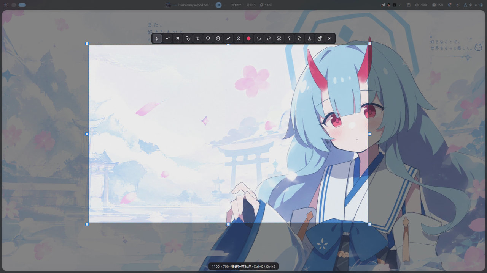
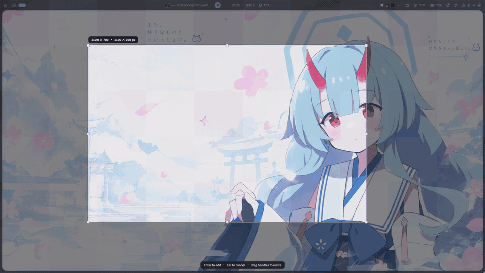
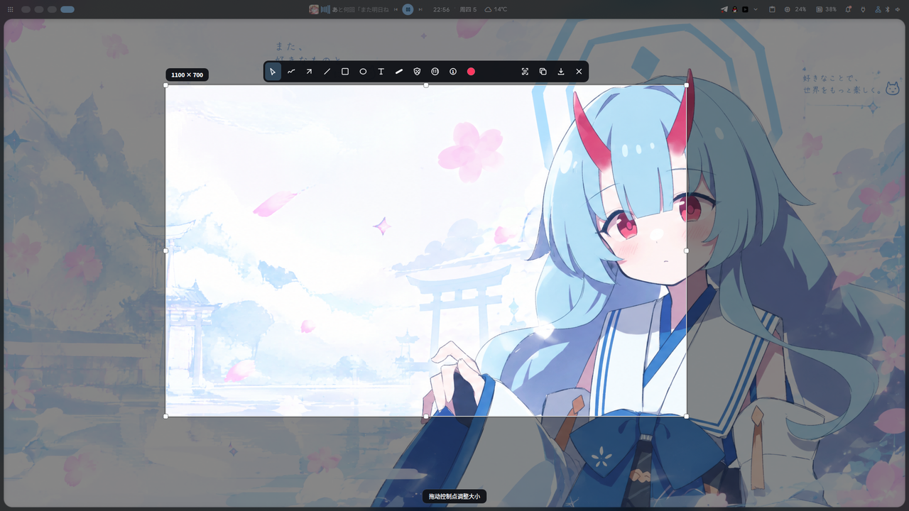
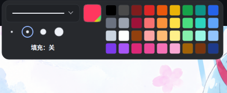
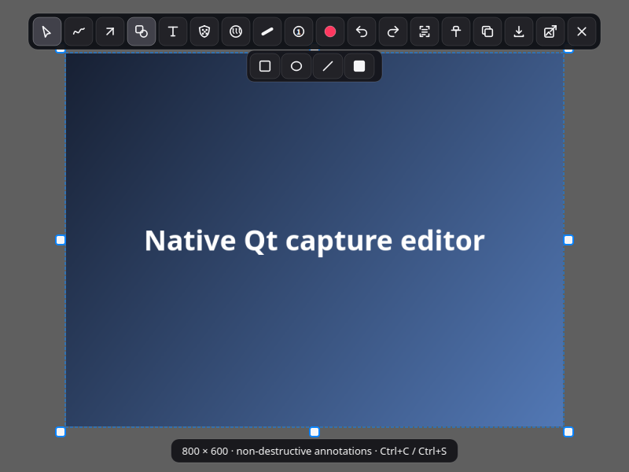
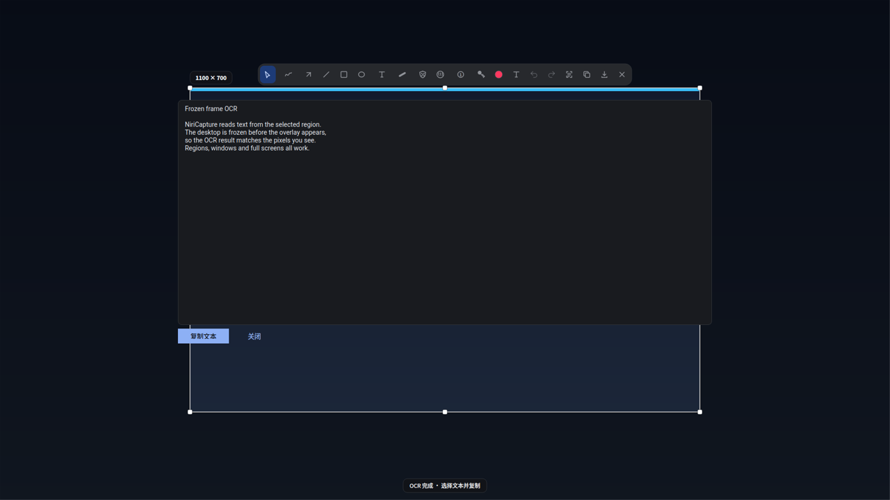
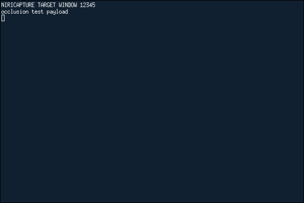
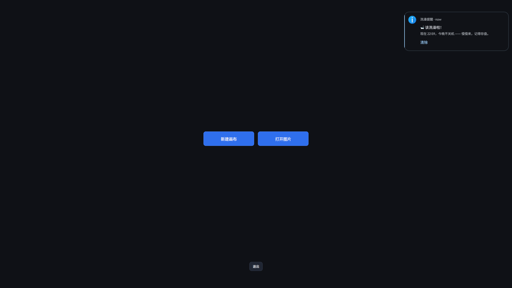
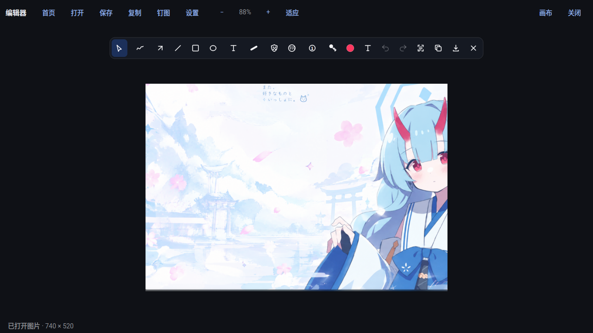
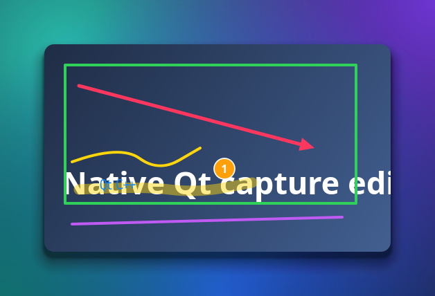

# NiriCapture

[**English**](README.md) | [简体中文](README.zh-CN.md)

A native screenshot tool for **Niri + DankMaterialShell (DMS)** on Arch Linux.

NiriCapture freezes the desktop through DMS, draws a multi-output selection
overlay, then turns that frozen selection into an in-place annotation editor
with a compact floating toolbar. Window captures use **Niri's compositor-side window renderer**, not a
crop of the desktop, so occluded and off-workspace windows are captured
completely.



## UI preview

The clip below is a real screen recording: DMS freezes the desktop, the
region overlay becomes the in-place editor, and the colour/shape panels are
shown with `Q`.



[MP4](docs/screenshots/preview.mp4) · [WebM](docs/screenshots/preview.webm) ·
[poster](docs/screenshots/preview-poster.png)

### More screenshots

| Region selection | Editor |
|---|---|
|  |  |
| **Colour / width** | **Standalone editor: shape panel** |
|  |  |
| **OCR result** | **Native window capture** |
|  |  |
| **Annotation export** | |
|  |  |
|  | |

## What works

- Niri-first, DMS-backed region and fullscreen capture.
- Native window capture through `niri msg action screenshot-window --id`.
  Works when the window is fully covered by another window or lives on an
  inactive workspace.
- One process, no shell plugin, no daemon, no Quickshell dependency at runtime.
- Frozen-frame selection across all outputs, with correct logical ↔ physical
  coordinate mapping and fractional-scale export.
- Non-destructive annotations: select/move/resize, pen, arrow, line, outlined
  or filled rectangle, outlined or filled ellipse, text, highlighter, truly
  pixelated mosaic, real Gaussian blur, numbered markers, undo/redo.
- Region and current-output fullscreen captures open the toolbar directly in
  the frozen selection overlay. There is no second window and no image jump.
- Selection handles resize against the full frozen output: a region can be
  enlarged again after shrinking, not just cropped smaller.
- UI follows the system locale; `NIRICAPTURE_LANG=zh_CN` or `en` overrides it.
- JSON config at `~/.config/niricapture/config.json` controls tools, shortcuts,
  palette, canvas defaults, theme, OCR languages and screenshot paths.
- Compact Material-inspired toolbar near the image with direct shape buttons
  and a colour/line-width popup; works on dark and light desktops.
- Copy/save with `wl-copy`; offline OCR through Tesseract with selectable text.
- Image pinning, opening an image file or clipboard image in the editor.
- No changes to Niri, DMS or Quickshell sources or configuration.

## Capture paths

### Region: DMS frozen frames

```
niri msg --json outputs          # geometry, scale, physical size
        │
        ├─ dms screenshot output -o OUTPUT --stdout --no-clipboard --no-file
        │       (once per output)
        ▼
  DesktopFrames (immutable QImages + logical geometry)
        │
        ▼
  one layer-shell overlay per output, shared global selection
        │  drag release
        ▼
  in-place toolbar + EditorCanvas on the frozen owner overlay
        │  copy / save
        ▼
  composeSelection() at the owning output's scale
```

Nothing is recaptured after the overlays are mapped. The toolbar and
annotations are painted by the frozen selection overlay itself, so the image
stays at its exact screen position and selection handles can expand or shrink
the region at any time. This is the same freeze mechanism DMS Screenshot+ uses
(`dms screenshot output` before mapping its Quickshell overlay), but without
the Quickshell `ScreencopyView` crash documented in
[DMS Screenshot+](https://github.com/pcmid/dms-screenshot-plus#backends) and
[quickshell#1094](https://github.com/quickshell-mirror/quickshell/issues/1094).

`dms screenshot output --stdout` emits raw PNG bytes; `--json` would emit
capture metadata and is not mixed with the image path. NiriCapture drains the
pipe while the process runs, so large multi-monitor PNGs cannot deadlock.

If the DMS CLI is unavailable, NiriCapture falls back to `grim -o OUTPUT -`
for the same still frame. Window capture never uses this fallback.

### Window: Niri-native independent render

`niri msg action screenshot-window --id ID --path PATH --write-to-disk true`
maps to Niri's `Action::ScreenshotWindowById`. Niri looks up the mapped window,
then calls `Mapped::render` directly into an offscreen texture. It does not read
the composited desktop, so other windows are not part of the result, regardless
of stacking, workspace or output visibility. The image includes Niri's own
window decorations, rounded corners, shadow and alpha (window opacity).

The clipboard side effect is Niri's: `save_screenshot()` always installs the
raw window PNG as the Wayland clipboard selection. Niri exposes no flag to
disable that. NiriCapture later replaces it when you copy the annotated image;
cancelling after window selection leaves Niri's raw image on the clipboard.
This is a compositor limitation, not a hidden screenshot crop.

Niri 26.04's `screenshot-window --id` writes the PNG asynchronously after the
CLI process exits. NiriCapture therefore waits for a readable, non-empty file
and never treats exit code 0 alone as success.

### Fullscreen and all outputs

Both use `dms screenshot output` for each requested output and the same
composition code as region capture. "All outputs" is one image at the largest
involved output scale; gaps between logical monitor rectangles stay
transparent.

## Requirements

NiriCapture is built and tested on **Arch Linux / CachyOS**, Qt 6.8+.

```bash
sudo pacman -S --needed \
  base-devel cmake ninja pkgconf \
  qt6-base layer-shell-qt \
  grim wl-clipboard libnotify \
  tesseract tesseract-data-eng
# optional, recommended for Chinese OCR:
sudo pacman -S --needed tesseract-data-chi_sim
```

Runtime:

| Component | Required | Purpose |
|---|---|---|
| Niri 26.04 (tested) | yes | JSON IPC and native window capture |
| `dms` (`dux-shell`) | recommended | frozen-frame backend |
| `grim` | yes in practice | DMS fallback and output capture |
| `wl-clipboard` | yes | persistent Wayland clipboard |
| `layer-shell-qt` | yes | overlays and editor |
| `tesseract` | optional | offline OCR |
| `libnotify` | optional | notifications |

NiriCapture does **not** need Quickshell, Noctalia, Hyprland headers or a
compositor plugin. DMS is only called through its public CLI.

## Build and run

```bash
git clone https://github.com/waraku-chise/niricapture.git
cd niricapture
cmake -S . -B build -G Ninja -DCMAKE_BUILD_TYPE=Release
cmake --build build --parallel

# region capture
./build/niricapture --capture-region

# native window capture through Niri's picker
./build/niricapture --capture-window

# focused output / all outputs
./build/niricapture --capture-fullscreen
./build/niricapture --capture-all

# no editor, direct output
./build/niricapture --capture-region --copy
./build/niricapture --capture-fullscreen --save
```

### Local installer

```bash
./packaging/install-local.sh --check   # dry run, no writes
./packaging/install-local.sh           # asks sudo only for pacman
```

The installer builds in `~/.cache/niricapture/build`, refuses to overwrite an
existing installation, and never edits Niri or DMS configuration. It installs
under `~/.local` by default (`NIRICAPTURE_PREFIX` overrides it).

Remove it with:

```bash
./packaging/uninstall-local.sh --prefix ~/.local --check
./packaging/uninstall-local.sh --prefix ~/.local
```

### Arch package

`packaging/PKGBUILD` builds `niricapture-git`:

```bash
cd packaging
makepkg -si
```

### Debian package

Release assets include `niricapture_<version>_amd64.deb`:

```bash
sudo apt install ./niricapture_0.6.1_amd64.deb
```

The Debian package is built from the Arch/Qt 6.12 binary. It targets Debian
testing/unstable or a distribution carrying Qt 6.12 and LayerShellQt. It is a
convenience artifact; Arch/Niri/DMS remains the primary target. Build it
locally with `./packaging/make-deb.sh build dist`.

## Niri bindings

Install does **not** touch your config. Add these inside your existing
`binds { ... }` block, or include
`~/.local/share/niricapture/niricapture-keybinds.kdl`:

```kdl
binds {
    Mod+Shift+S repeat=false hotkey-overlay-title="Screenshot: NiriCapture region" {
        spawn "niricapture" "--capture-region";
    }
    Ctrl+F1 repeat=false hotkey-overlay-title="Screenshot: NiriCapture window" {
        spawn "niricapture" "--capture-window";
    }
    Mod+Shift+A repeat=false hotkey-overlay-title="Screenshot: NiriCapture all outputs" {
        spawn "niricapture" "--capture-all";
    }
    Ctrl+Shift+S repeat=false hotkey-overlay-title="Screenshot: NiriCapture focused output" {
        spawn "niricapture" "--capture-fullscreen";
    }
}
```

If DMS already binds `Print`/`Ctrl+Print`, comment those lines out or choose
different keys. Then run `niri validate`.

## Usage

### Region selection

| Input | Action |
|---|---|
| Drag on the frozen desktop | Create a region |
| Drag inside | Move |
| Drag a corner or edge handle | Resize |
| Arrow keys / Shift+arrows | Nudge by 1 / 10 logical px |
| `F` | Select the whole frozen desktop |
| `Enter` | Open the annotation editor |
| `Esc` / right click | Cancel |

The size pill shows logical and physical pixels. On fractional scales, export
uses the native pixels of the output that owns the largest part of the
selection.

### Window selection

Niri's native picker is used for interactive selection: it highlights windows
and returns the stable id/title, then NiriCapture asks Niri to render that exact
window. For scripts:

```bash
niricapture --list-windows
niricapture --window-id 42 --save
```

`--list-windows` prints stable ids, titles and app ids as compact JSON. Niri's
window IPC exposes layout-relative fields but **not** the current scrolling
viewport offset or absolute screen position of every window, so NiriCapture
does not pretend it can build a pixel-accurate custom hover overlay across the
scrolling layout. The compositor picker is the reliable selection surface.

### Standalone editor

The launcher entry **NiriCapture Editor** runs:

```bash
niricapture --editor
```

It opens a normal application window with:

- **New canvas** — choose width/height and start from a transparent canvas.
- **Open image** — edit a PNG/JPEG/WebP/BMP/GIF frame.
- **Canvas** — resize the canvas, set padding, and choose a transparent,
  white, dark, or gradient background.
- **Zoom** — `−` / `+` / `Fit`, or Ctrl+wheel. Pan with middle-drag or
  Space+drag.
- Save, copy, pin, OCR, and the same annotation tools as the screenshot editor.

Window captures open this editor directly with the rendered window image; they
no longer use the old `CaptureEditor` window.

### Editor keys

| Key | Tool / action |
|---|---|
| `V` | Select / move / resize |
| `F` | Pen |
| `A` / `L` | Arrow / line |
| `R` / `E` | Rectangle / ellipse |
| `T` | Text |
| `Q` | Colour / line-width popup |
| `H` | Highlighter |
| `C` | Numbered marker |
| `D` | Mosaic (D toggles solid/pixelate) |
| `B` | Gaussian blur (wheel changes radius) |
| `O` | OCR a region |
| `Ctrl+Z` / `Ctrl+Shift+Z` | Undo / redo |
| `Delete` | Delete selected annotation |
| Wheel | Scale selected annotation / tool size |
| `Ctrl+C` / `Ctrl+S` | Copy / save |
| `Enter` | Copy and save |
| `Esc` | Close popup, then editor |

Shape, colour, line-width, and extra actions are grouped in floating popups.
The toolbar follows the image and clamps to screen edges.

### Annotations

| Tool | Data | Export behaviour |
|---|---|---|
| Pen / highlighter | polyline + colour + width | vector over image |
| Arrow / line | two endpoints | vector |
| Rectangle / ellipse | rect + outlined/filled | vector |
| Text | origin + UTF-8 text + size | vector |
| Number | point + order | vector, auto-renumbered |
| Mosaic | rect + seed + solid/pixelate | replaces source pixels |
| Blur | rect + radius | replaces source pixels with Gaussian blur |
| Spotlight / Cutout | legacy standalone editor only | not yet exposed by the modular editor |

Annotations live in source-image coordinates and are stored separately from
the original image. Export composites them at native resolution; the source
pixels are never destructively edited by vector tools.

### OCR

Offline OCR is performed by Tesseract on a worker thread; the overlay stays
interactive. Small crops are upscaled before recognition. The result opens in a
selectable text panel; `Copy text` writes it to the Wayland clipboard.

- English is the default.
- If `tesseract-data-chi_sim` is installed, `eng+chi_sim` is selected
  automatically.
- Override with `NIRICAPTURE_OCR_LANGS=eng+chi_sim` (same syntax as Tesseract).

Tesseract is an optional dependency: without it the rest of the editor works.

## Architecture

```
src/main.cpp             CLI, instance lock, mode dispatch, layer shell setup
src/capture.*            clipboard, OCR, rendering, vector/source annotations
src/desktop-capture.*    Niri output discovery, DMS frames, composition math
src/region-selector.*    one layer surface per output, global frozen selection
src/editor/             modular tools, registry, toolbar, canvas, document
src/editor-window.*     standalone New/Open editor window
src/editor.cpp          legacy editor kept for regression tests
src/surface-capture.cpp  Niri-native window rendering + async file handling
src/pin.*                always-visible pinned images
src/instance-lock.*      single-instance hand-off and stale-lock recovery
tests/                   offscreen Qt smoke, composition and contract tests
packaging/               Arch installer, uninstaller, PKGBUILD, keybinds
```

Plain Qt 6 Widgets + LayerShellQt. No QML runtime, no Quickshell, no
compositor plugin, no privileged helper. Capture processes communicate only
through documented Niri IPC and the DMS CLI.

## Research, licences and deliberate limits

See [docs/CONFIGURATION.md](docs/CONFIGURATION.md) for the JSON config
(tools, shortcuts, palette, canvas, theme, OCR), and
[docs/EDITOR-ARCHITECTURE.md](docs/EDITOR-ARCHITECTURE.md) for the tool
module map and [docs/RESEARCH.md](docs/RESEARCH.md) for the source-level review of DMS
Screenshot+, HyprCapture and Niri 26.04, including the exact protocol/API
limits and licence analysis.

Important limits:

- Niri always overwrites the clipboard with its raw window image. There is no
  IPC flag to suppress it.
- Niri has no IPC cancel action for its picker. NiriCapture closes the pick-window client on a second invocation or SIGTERM; `Esc` or a click also resolves it.
- DMS captures outputs one at a time in this implementation. Other DMS
  screenshot selectors share a one-at-a-time guard.
- Cross-output selections are supported for region capture and composition.
  Window capture is always a single Niri window, even when it crosses outputs.
- Scroll capture, GIF/video recording, a result thumbnail popup and a custom
  pixel-accurate scrolling-layout window hover map are **not implemented**.
- There is no xdg-desktop-portal/PipeWire fallback. Niri's native window action
  is used because it is exact; a portal/PipeWire video stream would add latency
  and still require frame extraction.

Licences:

- NiriCapture as a whole: **AGPL-3.0-only** (`LICENSE`).
- Derived from Nirisnap (MIT); notice in `NOTICE` and
  `LICENSES/MIT-nirisnap.txt`.
- DMS Screenshot+: MIT, studied for its frozen-frame workflow; no verbatim
  source copied.
- HyprCapture: GPL-3.0, studied for UI/interaction design only; no code copied
  and no Hyprland dependency introduced.

## Tests

```bash
make check
```

This runs the 17 Python contract checks, the offscreen Qt interaction suite
and the composition/OCR suite. Run `make lint` separately for static analysis;
it is intentionally not part of the default check because clang-tidy is slow.

The live tests used during development are documented in
[docs/TESTING.md](docs/TESTING.md): real DMS region capture pixel-identical to
the frozen frame, Niri window capture while fully covered, an inactive
workspace window, transparent windows, and Chinese/English OCR.

## Status

Version `0.6.1`. The core acceptance path is implemented and tested on Niri
26.04 + DMS 2.0. Region/fullscreen editing is in-place in the frozen overlay;
window/file editing uses the new standalone New/Open editor. Multi-output composition has
synthetic coverage; only one physical output was available during live testing.
