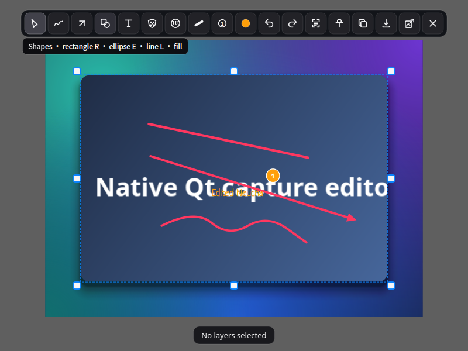
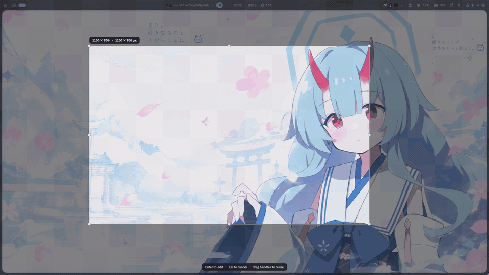
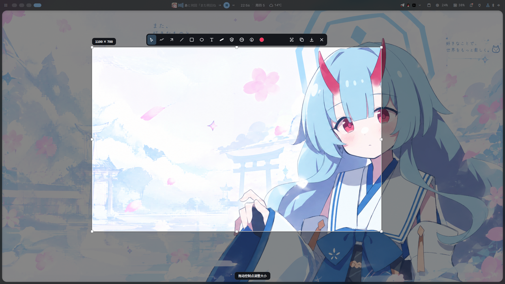
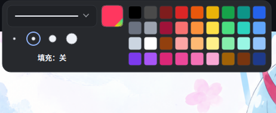
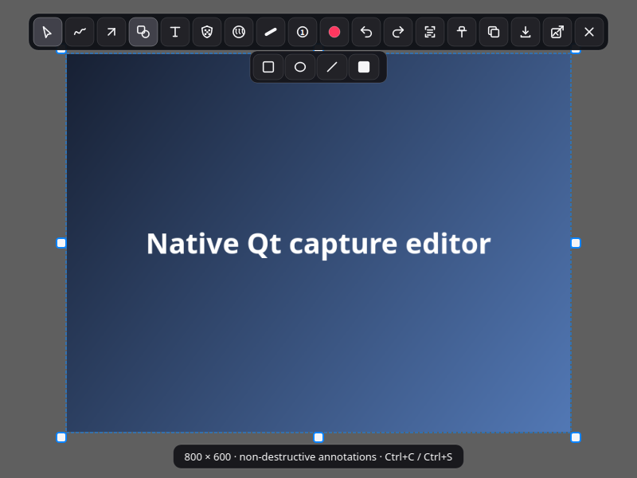
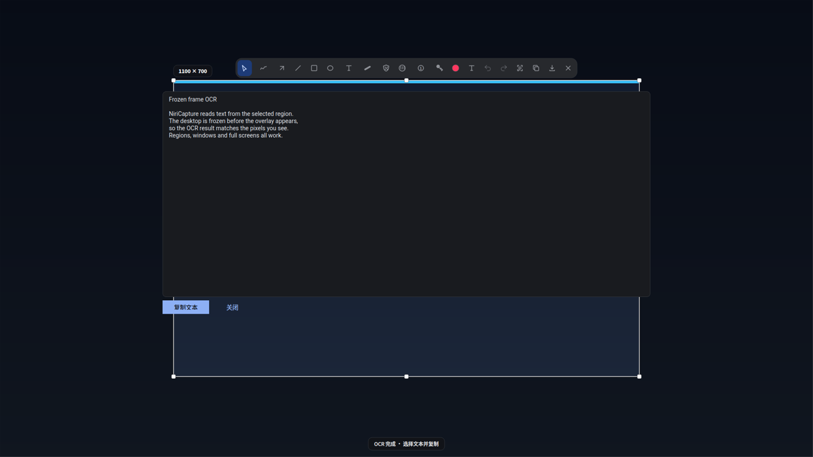
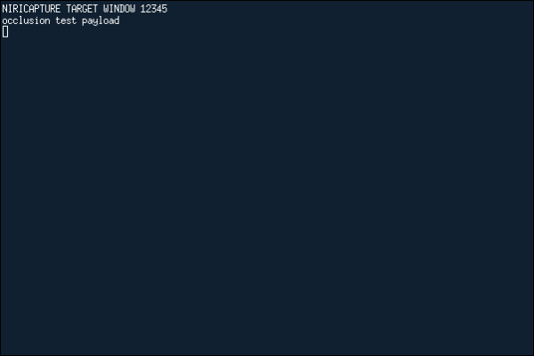
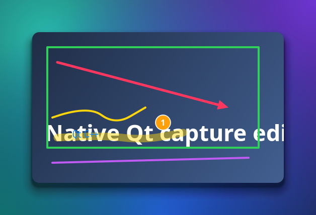

# NiriCapture

[English](README.md) | **简体中文**

面向 **Niri + DankMaterialShell（DMS）** 的 Arch Linux 原生截图工具。

NiriCapture 先通过 DMS 冻结桌面，再在所有输出上绘制选区覆盖层，随后打开一个
独立的标注编辑器，工具栏以紧凑的悬浮面板呈现。窗口截图使用 **Niri 合成器侧的
窗口独立渲染**，不是从桌面截图中裁剪，因此被其他窗口完全遮挡的窗口、以及位于
非当前工作区的窗口，都能完整截取。



## 界面预览

下面的动图来自真实录屏：DMS 冻结桌面、区域覆盖层出现、编辑器打开，
并用 `Q` / `G` 展示颜色与形状弹出面板。



[MP4](docs/screenshots/preview.mp4) · [WebM](docs/screenshots/preview.webm) ·
[封面图](docs/screenshots/preview-poster.png)

### 更多截图

| 区域选区 | 编辑器 |
|---|---|
|  |  |
| **颜色 / 线宽** | **形状面板** |
|  |  |
| **OCR 结果** | **Niri 原生窗口截图** |
|  |  |
| **标注导出** | |
|  | |

## 已实现功能

- Niri 优先、DMS 提供冻结帧的区域截图与整屏截图。
- 通过 `niri msg action screenshot-window --id` 进行原生窗口截图。即使目标窗口
  被其他窗口完全覆盖，或位于未激活的工作区，也能正确截取。
- 单进程运行，不依赖 Shell 插件、守护进程或 Quickshell。
- 支持多输出冻结帧选区，正确处理逻辑坐标与物理像素的转换，以及小数缩放。
- 非破坏性标注：选择/移动/缩放、画笔、箭头、直线、空心/填充矩形、
  空心/填充椭圆、文字、高亮、真正的像素化马赛克、真实高斯模糊、序号标记、
  撤销/重做。
- 编辑器会保持区域截图在屏幕上的原始位置和比例，不会跳到屏幕中央，
  因此图像与后面的冻结桌面严格对齐。
- 靠近图像的 Material 风格紧凑工具栏，提供形状、颜色、线宽弹出面板；
  在深色和浅色桌面上都能正常使用。
- 通过 `wl-copy` 复制、保存 PNG；可选 Tesseract 离线 OCR，识别结果可选中复制。
- 支持把截图钉在屏幕上，也支持打开图片文件或剪贴板图片进入编辑器。
- 不修改 Niri、DMS 或 Quickshell 的源码或配置。

## 截图路径

### 区域截图：DMS 冻结帧

```
niri msg --json outputs          # 逻辑几何、缩放、物理尺寸
        │
        ├─ dms screenshot output -o OUTPUT --stdout --no-clipboard --no-file
        │       （每个输出调用一次）
        ▼
  DesktopFrames（不可变 QImage + 逻辑坐标）
        │
        ▼
  每个输出一个 layer-shell 覆盖层，共享同一个全局选区
        │  Enter
        ▼
  composeSelection()：按选区主要所属输出的缩放合成
        │
        ▼
  独立的 CaptureEditor（不依赖 DMS Shell 生命周期）
```

覆盖层映射之后不会再重新抓屏。编辑器拿到的是一张已经合成好的静态图像。这与
DMS Screenshot+ 使用的冻结机制相同（先 `dms screenshot output`，再映射
Quickshell 覆盖层），但没有使用后者存在崩溃风险的 Quickshell
`ScreencopyView`。相关记录见
[DMS Screenshot+](https://github.com/pcmid/dms-screenshot-plus#backends) 和
[quickshell#1094](https://github.com/quickshell-mirror/quickshell/issues/1094)。

`dms screenshot output --stdout` 输出的是原始 PNG 字节；`--json` 输出的是截图
元数据，两者不会混在一起。NiriCapture 在 DMS 进程运行期间持续读取管道，
避免多显示器大图把管道写满导致死锁。

如果 DMS CLI 不可用，区域/整屏截图会回退到 `grim -o OUTPUT -` 获取同一帧静态
画面。窗口截图**绝不**使用这个回退。

### 窗口截图：Niri 原生独立渲染

`niri msg action screenshot-window --id ID --path PATH --write-to-disk true`
对应 Niri 的 `Action::ScreenshotWindowById`。Niri 会查找目标窗口，然后直接调用
`Mapped::render` 渲染到离屏纹理。它不读取合成后的桌面，因此无论窗口层级、
工作区或输出可见性如何，其他窗口都不会进入结果。图像会保留 Niri 自己的窗口
装饰、圆角、阴影和 alpha（窗口透明度）。

剪贴板副作用来自 Niri：`save_screenshot()` 总会把原始窗口 PNG 设置为 Wayland
剪贴板内容，Niri 没有关闭该行为的参数。之后在 NiriCapture 中复制标注结果时，
剪贴板会被覆盖；如果在选完窗口后取消，剪贴板上会保留 Niri 的原始窗口图。
这是合成器的限制，不是偷偷改用了桌面裁剪。

Niri 26.04 的 `screenshot-window --id` 会在 CLI 进程退出后异步写入 PNG。
NiriCapture 因此会等待文件可读且非空，绝不只凭退出码 0 判断成功。

### 整屏与全部输出

两者都对所需输出调用 `dms screenshot output`，并复用区域截图的合成代码。
“全部输出”会以涉及输出中的最大缩放生成一张图；逻辑显示器矩形之间的空隙保持
透明。

## 依赖要求

NiriCapture 在 **Arch Linux / CachyOS**、Qt 6.8+ 上构建和测试。

```bash
sudo pacman -S --needed \
  base-devel cmake ninja pkgconf \
  qt6-base layer-shell-qt \
  grim wl-clipboard libnotify \
  tesseract tesseract-data-eng
# 中文 OCR 可选但推荐：
sudo pacman -S --needed tesseract-data-chi_sim
```

运行时依赖：

| 组件 | 是否必需 | 用途 |
|---|---|---|
| Niri 26.04（已测试） | 是 | JSON IPC 与原生窗口截图 |
| `dms`（`dux-shell`） | 推荐 | 冻结帧后端 |
| `grim` | 实际必需 | DMS 回退与输出抓取 |
| `wl-clipboard` | 是 | 持久 Wayland 剪贴板 |
| `layer-shell-qt` | 是 | 覆盖层与编辑器 |
| `tesseract` | 可选 | 离线 OCR |
| `libnotify` | 可选 | 桌面通知 |

NiriCapture **不**需要 Quickshell、Noctalia、Hyprland 头文件或合成器插件。
DMS 只通过公开 CLI 调用。

## 构建与运行

```bash
git clone https://github.com/waraku-chise/niricapture.git
cd niricapture
cmake -S . -B build -G Ninja -DCMAKE_BUILD_TYPE=Release
cmake --build build --parallel

# 区域截图
./build/niricapture --capture-region

# 通过 Niri 原生 picker 选择窗口
./build/niricapture --capture-window

# 当前输出 / 全部输出
./build/niricapture --capture-fullscreen
./build/niricapture --capture-all

# 不打开编辑器，直接复制或保存
./build/niricapture --capture-region --copy
./build/niricapture --capture-fullscreen --save
```

### 本地安装脚本

```bash
./packaging/install-local.sh --check   # 只检查，不写文件
./packaging/install-local.sh           # 只有 pacman 需要 sudo
```

安装脚本在 `~/.cache/niricapture/build` 中构建，拒绝覆盖已有安装，并且不会修改
Niri 或 DMS 配置。默认安装到 `~/.local`，可通过 `NIRICAPTURE_PREFIX` 覆盖。

卸载：

```bash
./packaging/uninstall-local.sh --prefix ~/.local --check
./packaging/uninstall-local.sh --prefix ~/.local
```

### Arch 软件包

`packaging/PKGBUILD` 构建 `niricapture-git`：

```bash
cd packaging
makepkg -si
```

## Niri 快捷键

安装过程**不会**改动你的配置。把下面内容加入已有的 `binds { ... }` 块，或者
include `~/.local/share/niricapture/niricapture-keybinds.kdl`：

```kdl
binds {
    Mod+Shift+S repeat=false hotkey-overlay-title="Screenshot: NiriCapture region" {
        spawn "niricapture" "--capture-region";
    }
    Mod+Shift+W repeat=false hotkey-overlay-title="Screenshot: NiriCapture window" {
        spawn "niricapture" "--capture-window";
    }
    Mod+Shift+A repeat=false hotkey-overlay-title="Screenshot: NiriCapture all outputs" {
        spawn "niricapture" "--capture-all";
    }
    Ctrl+Shift+S repeat=false hotkey-overlay-title="Screenshot: NiriCapture focused output" {
        spawn "niricapture" "--capture-fullscreen";
    }
}
```

如果 DMS 已经绑定了 `Print`/`Ctrl+Print`，请注释掉对应的 DMS 行，或改用其他
按键。修改后运行 `niri validate`。

## 使用说明

### 区域选区

| 输入 | 操作 |
|---|---|
| 在冻结桌面上拖动 | 创建选区 |
| 在选区内拖动 | 移动选区 |
| 拖动角或边缘手柄 | 调整选区大小 |
| 方向键 / Shift+方向键 | 每次移动 1 / 10 逻辑像素 |
| `F` | 选中整个冻结桌面 |
| `Enter` | 进入标注编辑器 |
| `Esc` / 右键 | 取消 |

尺寸提示同时显示逻辑像素和物理像素。在小数缩放下，导出会使用选区主要所属
输出的原生物理像素。

### 窗口选择

交互式选择使用 Niri 原生 picker：它会高亮窗口并返回稳定 id/title，随后
NiriCapture 让 Niri 渲染该窗口。脚本用法：

```bash
niricapture --list-windows
niricapture --window-id 42 --save
```

`--list-windows` 输出紧凑 JSON，包含稳定 id、标题、应用 id、工作区、焦点、
浮动状态和窗口尺寸。Niri 的窗口 IPC 只提供布局相对坐标，**不**提供当前滚动
视口的偏移量，也不提供每个窗口的绝对屏幕位置，因此 NiriCapture 不会假装能够
在滚动布局上实现像素级准确的自定义 hover 覆盖层。Niri 合成器 picker 才是可靠
的选择入口。

### 编辑器快捷键

| 按键 | 工具 / 操作 |
|---|---|
| `V` | 选择 / 移动 / 缩放 |
| `F` | 画笔 |
| `A` / `L` | 箭头 / 直线 |
| `R` / `E` | 矩形 / 椭圆 |
| `T` | 文字 |
| `Q` / `G` | 颜色 / 形状弹出面板 |
| `H` | 高亮 |
| `C` | 序号标记 |
| `D` | 马赛克（再按 D 切换实心/像素化） |
| `B` | 高斯模糊（滚轮调整半径） |
| `O` | 对区域做 OCR |
| `Ctrl+Z` / `Ctrl+Shift+Z` | 撤销 / 重做 |
| `Delete` | 删除选中的标注 |
| 滚轮 | 缩放选中标注 / 调整工具大小 |
| `Ctrl+C` / `Ctrl+S` | 复制 / 保存 |
| `Enter` | 复制并保存 |
| `Esc` | 先关闭弹出面板，再关闭编辑器 |

形状、颜色、线宽和附加操作都收在悬浮弹出面板中。工具栏跟随图像，并自动限制
在屏幕边缘内。

### 标注

| 工具 | 数据结构 | 导出行为 |
|---|---|---|
| 画笔 / 高亮 | 折线 + 颜色 + 宽度 | 在图像上绘制矢量 |
| 箭头 / 直线 | 两个端点 | 矢量 |
| 矩形 / 椭圆 | 矩形 + 空心/填充 | 矢量 |
| 文字 | 起点 + UTF-8 文本 + 字号 | 矢量 |
| 序号 | 点 + 创建顺序 | 矢量，删除后自动重新编号 |
| 马赛克 | 矩形 + 随机种子 + 实心/像素化 | 替换源像素 |
| 模糊 | 矩形 + 半径 | 用高斯模糊替换源像素 |
| 聚光灯 | 矩形 + 放大倍率 | 采样已经过马赛克/模糊处理的像素 |
| 剪切条 | 条带 | 修改工作位图，可撤销 |

标注保存在源图像坐标系中，并与原图分开存储。导出时按原生分辨率合成；
矢量工具不会破坏原图像素。

### OCR

离线 OCR 由 Tesseract 在后台线程执行，覆盖层保持可交互。较小的裁剪图会先
放大再识别。识别结果会进入可选择文本面板，点击“Copy text”写入 Wayland
剪贴板。

- 默认语言为英文。
- 如果安装了 `tesseract-data-chi_sim`，自动使用 `eng+chi_sim`。
- 可以通过 `NIRICAPTURE_OCR_LANGS=eng+chi_sim` 覆盖（语法与 Tesseract 相同）。

Tesseract 是可选依赖；没有它时编辑器的其他功能仍然可用。

## 架构

```
src/main.cpp             命令行、单实例锁、模式分发、layer-shell 初始化
src/capture.*            剪贴板、OCR、渲染、矢量/源像素标注
src/desktop-capture.*    Niri 输出发现、DMS 冻结帧、合成数学
src/region-selector.*    每个输出一个 layer surface，共享冻结选区
src/editor.*             标注编辑器、工具栏、导出、OCR 面板
src/surface-capture.cpp  Niri 原生窗口渲染 + 异步文件等待
src/pin.*                固定在屏幕上的截图
src/instance-lock.*      单实例交接与残留锁恢复
tests/                   离屏 Qt 冒烟、合成与契约测试
packaging/               Arch 安装/卸载脚本、PKGBUILD、快捷键
```

使用纯 Qt 6 Widgets + LayerShellQt。没有 QML 运行时、没有 Quickshell、
没有合成器插件、没有特权 helper。截图进程只通过公开的 Niri IPC 和 DMS CLI
通信。

## 研究、许可证与明确限制

DMS Screenshot+、HyprCapture 和 Niri 26.04 的源码级分析、协议/API 限制和
许可证分析见 [docs/RESEARCH.md](docs/RESEARCH.md)。

重要限制：

- Niri 总会用原始窗口图覆盖剪贴板，没有 IPC 参数可以关闭。
- Niri 的 picker 没有 IPC 取消动作。第二次启动或发送 SIGTERM 时，
  NiriCapture 会关闭 pick-window 客户端；`Esc` 或点击窗口也可以结束。
- 当前实现中 DMS 输出是逐个抓取的；其他 DMS 截图选择器共享同一时间只能有
  一个的限制。
- 区域截图和合成支持跨输出选区。窗口截图始终是一个 Niri 窗口，即使它跨输出。
- 滚动截图、GIF/视频录制、结果缩略图弹窗、以及基于滚动布局的像素级窗口
  hover 覆盖层**尚未实现**。
- 没有 xdg-desktop-portal/PipeWire 回退。Niri 原生窗口动作已经足够精确；
  portal/PipeWire 视频流会增加延迟，而且仍然需要抽帧。

许可证：

- NiriCapture 整体：**AGPL-3.0-only**（`LICENSE`）。
- 派生自 Nirisnap（MIT）；声明见 `NOTICE` 和
  `LICENSES/MIT-nirisnap.txt`。
- DMS Screenshot+：MIT，仅研究其冻结帧流程；没有逐字复制源码。
- HyprCapture：GPL-3.0，仅参考 UI/交互设计；没有复制代码，也没有引入
  Hyprland 依赖。

## 测试

```bash
make check
```

该命令运行 17 个 Python 契约测试、离屏 Qt 交互套件，以及合成/OCR 套件。
`make lint` 是独立的静态分析命令，因为 clang-tidy 较慢，默认不放进
`make check`。

开发期间的实机测试记录见 [docs/TESTING.md](docs/TESTING.md)，包括：DMS 区域
截图与冻结帧逐像素一致、窗口被完全遮挡时的 Niri 原生捕获、非当前工作区窗口、
透明窗口，以及中英文 OCR。

## 状态

版本 `0.1.0`。核心验收路径已实现，并在 Niri 26.04 + DMS 2.0 上测试。
多输出合成有合成测试覆盖；实机环境只有一块物理显示器，因此未做真实双屏
端到端测试。
